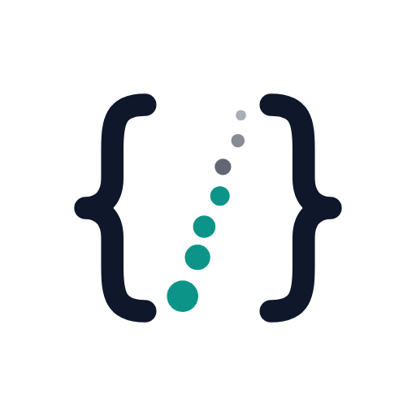

<picture>
  <source media="(prefers-color-scheme: dark)" srcset="assets/logo-dark.png">
  
</picture>

# Jonathan Scholtes

**Applied AI architect @ Microsoft. I build AI systems that move a business number, and I build them with the people who will run them.**

 

Every repo here is a working reference architecture: deployable infrastructure, real code, and a write-up explaining the design decisions. Most pair with a deep dive on [stochasticcoder.com](https://stochasticcoder.com).

[stochasticcoder.com](https://stochasticcoder.com) • [LinkedIn](https://linkedin.com/in/jonathanscholtes/)

---

## 🚀 Featured Patterns

Production patterns that move past prompt and response into tool-driven execution, governed autonomy, and measurable outcomes.

*   **[ACH Remittance Intelligence](https://github.com/jonathanscholtes/Azure-AI-Foundry-Remittance-Intelligence)**  
    Turns messy remittance emails (PDFs, spreadsheets, scans, EDI printouts) into payment data reconciled to the cent, with gated agents for exceptions and per-run AI cost on a dashboard.
    *   **Key Patterns:** Deterministic first, generative second, verified always · gated agents with cited RAG · Durable Functions orchestration · per-run cost metering

*   **[Self-Healing Pipelines with Azure SRE Agent](https://github.com/jonathanscholtes/azure-sre-agent-github-demo)**  
    Takes a production failure spike to an automated code fix and a merged GitHub PR, with a human approving only the final merge.
    *   **Key Patterns:** Agentic reliability · autonomous remediation loops · GitHub Copilot integration

*   **[Fabric + Foundry Insight & Presentation Agents](https://github.com/jonathanscholtes/Fabric-Foundry-Insight-Presentation-Agents)**  
    Cuts business-review prep from hours to minutes: a Fabric Data Agent answers questions over live data, and Foundry agents generate the PowerPoint deck through MCP.
    *   **Key Patterns:** Fabric Data Agent interface · multi-turn reasoning over live data · MCP-driven document generation

*   **[Microsoft Foundry Agentic Workshop](https://github.com/jonathanscholtes/azure-ai-foundry-agentic-workshop)**  
    A hands-on workshop for building agentic systems end to end: vector search, multi-agent orchestration with LangGraph, and evaluation.
    *   **Key Patterns:** Developer enablement · multi-agent evaluation · LangGraph orchestration

*   **[Travel AI Agent](https://github.com/jonathanscholtes/Travel-AI-Agent-React-FastAPI-and-Cosmos-DB-Vector-Store)**  
    A full-stack conversational agent that answers traveler questions and completes bookings, with vector search and transactional state.
    *   **Key Patterns:** Tool-calling agents · vector search · stateful conversations

*   **[Always-On Contract Risk Platform](https://github.com/jonathanscholtes/contract-risk-mcp-foundry)**  
    Event-driven agents that continuously monitor FX and interest-rate contract risk, with auditable, repeatable evaluations.
    *   **Key Patterns:** Event-driven autonomy · MCP tool isolation · auditable decision trails

---

## 📰 Latest Posts

<!-- BLOG-POST-LIST:START -->
- [Decoupling Data and Logic: Using Fabric Data Agents and Foundry to Automate Presentation Generation](https://stochasticcoder.com/2026/06/22/decoupling-data-and-logic-using-fabric-data-agents-and-foundry-to-automate-presentation-generation/) · Jun 2026
<!-- BLOG-POST-LIST:END -->

➡️ [More on stochasticcoder.com](https://stochasticcoder.com)

---

## 🧭 Full Catalog

⭐ marks the featured patterns above.

### 🔍 Grounding AI in Enterprise Data

| Project | Services | Tech Stack | Pattern & Use Case |
|---|---|---|---|
| [BrandSense](https://github.com/jonathanscholtes/Azure-AI-Foundry-BrandSense) | Microsoft Foundry, Azure OpenAI, AI Search, APIM | Python, FastAPI, React, Terraform | Multi-agent brand analysis using retrieval, scoring, and validation workflows |
| [Contract Risk Platform](https://github.com/jonathanscholtes/contract-risk-mcp-foundry) ⭐ | Microsoft Foundry, AKS, Azure DocumentDB | Python, Bicep, MCP, OpenTelemetry | Always-on, event-driven contract risk monitoring with auditable workflows |
| [Travel AI Agent](https://github.com/jonathanscholtes/Travel-AI-Agent-React-FastAPI-and-Cosmos-DB-Vector-Store) ⭐ | Azure DocumentDB (Cosmos DB for MongoDB vCore) | Python, LangChain, FastAPI, React | Conversational agent with vector search, state management, and transactional workflows |
| [Full Stack RAG System](https://github.com/jonathanscholtes/LangChain-RAG-Pattern-with-React-FastAPI-and-Cosmos-DB-Vector-Store) | Azure DocumentDB (Cosmos DB for MongoDB vCore) | Python, LangChain, FastAPI, React | Enterprise retrieval-augmented generation pattern |
| [Semantic Kernel RAG System](https://github.com/jonathanscholtes/Azure-AI-Foundry-Semantic-Kernel-RAG) | Microsoft Foundry, AI Search, Cosmos DB, Durable Functions | Semantic Kernel, Python, FastAPI, Bicep | RAG orchestration and a foundation for agent-based systems |

### 🤖 Agentic Systems & Governance

| Project | Services | Tech Stack | Pattern & Use Case |
|---|---|---|---|
| [ACH Remittance Intelligence](https://github.com/jonathanscholtes/Azure-AI-Foundry-Remittance-Intelligence) ⭐ | Microsoft Foundry, Content Understanding, Durable Functions, AI Search, Service Bus, Container Apps | Python, FastAPI, React, Bicep | Remittance emails → verified payment data, with gated agents and per-run AI cost |
| [Self-Healing Pipelines (SRE Agent)](https://github.com/jonathanscholtes/azure-sre-agent-github-demo) ⭐ | Azure SRE Agent, Container Apps, Cosmos DB, Managed Identity | Python, FastAPI, Terraform, GitHub Actions | Incident detection to merged fix PR with autonomous remediation |
| [Fabric + Foundry Insight & Presentation Agents](https://github.com/jonathanscholtes/Fabric-Foundry-Insight-Presentation-Agents) ⭐ | Microsoft Fabric, Microsoft Foundry, Container Apps, Managed Identity | Python, FastAPI, FastMCP, python-pptx | Fabric Data Agent → conversational insight → MCP-generated business review decks |
| [Microsoft Foundry Agentic Workshop](https://github.com/jonathanscholtes/azure-ai-foundry-agentic-workshop) ⭐ | Microsoft Foundry, AI Search, Container Apps, Azure Functions | Python, LangGraph, Semantic Kernel, MCP | Multi-agent orchestration and evaluation patterns |
| [ITSM Multi-Agent System](https://github.com/jonathanscholtes/Azure-AI-Foundry-ITSM) | Microsoft Foundry, AI Search, APIM, Managed Identity | Python, FastAPI, React, Terraform | Agent-based ticket classification, routing, and remediation |
| [Agents Audit System](https://github.com/jonathanscholtes/Azure-AI-Foundry-Agents-Audit) | Foundry Agent Service, Azure OpenAI, AI Search, Cosmos DB | Python, FastMCP, Bicep | Agentic accounts-payable auditing with RAG, explainable reasoning, and policy compliance |

### 🏗️ Platform & Scale Patterns

| Project | Services | Tech Stack | Pattern & Use Case |
|---|---|---|---|
| [MCP YARP Gateway](https://github.com/jonathanscholtes/mcp-yarp-gateway) | AKS, Cosmos DB, Key Vault, Managed Identity | .NET, YARP, Bicep, Python | Secure MCP reverse proxy with controlled agent tool access |
| [Large Document Summarization](https://github.com/jonathanscholtes/Azure-AI-Large-Document-Summarization) | Azure OpenAI, Durable Functions, Blob Storage | Python, Bicep, PowerShell | Distributed fan-out/fan-in processing for large documents |
| [Microsoft Foundry Deployment](https://github.com/jonathanscholtes/Azure-AI-Foundry-Deployment) | Microsoft Foundry, AI Search, Private Endpoints, Managed Identity | Bicep, PowerShell | Enterprise deployment, networking, and security foundations |

---

## 📌 How I Build

*   **Outcome first:** Every architecture starts with the business case and the number it should move.
*   **System design over isolated prompts:** Prompts are brittle; architectures must be resilient.
*   **Governed autonomy:** Agents operate within explicit guardrails, with humans approving what matters.
*   **Observable by default:** Tracing and evaluation are non-negotiable for production agents.
